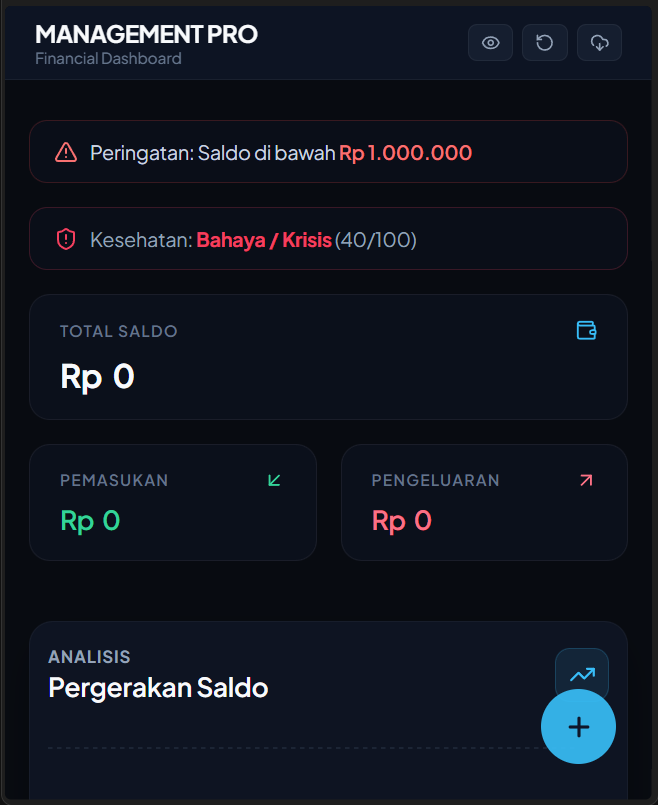

# FINANCE TRACKER

Aplikasi web modern berbasis **React + Vite** untuk mengelola keuangan pribadi secara efisien, menampilkan ringkasan saldo, pemasukan, pengeluaran, serta analisis keuangan secara real-time.
**BY GUSTI PANENGAH**

---

## TAMPILAN

---

## FITUR UTAMA

- **Dashboard Finansial**: Pantau Total Saldo, Pemasukan, dan Pengeluaran secara cepat.
- **Peringatan Saldo**: Notifikasi otomatis jika saldo berada di bawah batas tertentu.
- **Indikator Kesehatan Keuangan**: Analisis tingkat kesehatan finansial berbasis skor.
- **Grafik & Analisis**: Visualisasi pergerakan saldo dan tren pengeluaran.
- **Backup & Format Data**: Utilitas pendukung untuk manajemen data yang aman.

---

## TEKNOLOGI YANG DI GUNAKAN

- **React** (JavaScript Library)
- **Vite** (Frontend Tooling)
- **CSS3** (Styling Modern dengan kustom tema gelap)
